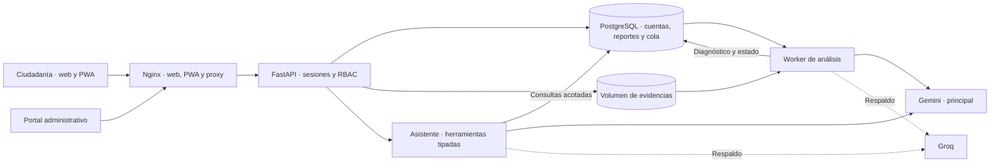

# CIVIA · Ciudad Inteligente y Vigilancia Ambiental

[](https://github.com/SeBytev3/CIVIA/releases/tag/v1.1.2)
[](https://github.com/SeBytev3/CIVIA/actions/workflows/civia.yml?query=branch%3Amain)
[](docker-compose.yml)
[](frontend/package.json)
[](backend/requirements.txt)
[](docker-compose.yml)

**Versión 1.1.2 · Momento 3** · Ingeniería de Aplicaciones con IA, Universidad Cooperativa de Colombia.

**Stefania Córdoba y Sebastian Espinosa** · Profesor Julián Garzón.

Plataforma académica de reportes viales y ambientales para Cali y el Valle del Cauca. La versión estable se distribuye en `main`, se despliega con Docker Compose y ofrece una PWA ciudadana como entrega móvil. El despliegue comprobado es local y en red privada. [Release](https://github.com/SeBytev3/CIVIA/releases/tag/v1.1.2) · [Aceptación](docs/estado.md)

## Contenido

- [Qué es CIVIA](#qué-es-civia)
- [Despliegue autónomo con tu agente de IA favorito](#despliegue-autónomo-con-tu-agente-de-ia-favorito)
- [Requisitos e instalación](#requisitos-e-instalación)
- [Experiencias, perfiles y acceso](#experiencias-perfiles-y-acceso)
- [URLs y servicios](#urls-y-servicios)
- [PWA ciudadana y red local](#pwa-ciudadana-y-red-local)
- [Configuración e inteligencia artificial](#configuración-e-inteligencia-artificial)
- [Arquitectura y estructura del repositorio](#arquitectura-y-estructura-del-repositorio)
- [Pruebas y verificación](#pruebas-y-verificación)
- [Seguridad y privacidad](#seguridad-y-privacidad)
- [Mantenimiento y diagnóstico](#mantenimiento-y-diagnóstico)
- [Desarrollo y colaboración](#desarrollo-y-colaboración)
- [Documentación técnica](#documentación-técnica)
- [Estado, limitaciones y próximos pasos](#estado-limitaciones-y-próximos-pasos)
- [Autores y licencia](#autores-y-licencia)

## Qué es CIVIA

Un reporte de un hueco, acumulación de residuos, tala o quema requiere evidencia, ubicación y un estado que se pueda consultar. CIVIA reúne esos datos bajo un radicado y permite que un equipo de casos documente su gestión. Es un proyecto universitario de demostración. El radicado confirma la recepción en CIVIA y carece de efecto administrativo ante la Alcaldía u otra autoridad. Las notificaciones se producen dentro de la plataforma.

| Capacidad | Qué hace CIVIA |
| --- | --- |
| Radicación y georreferenciación | Recibe descripción, fotografía y coordenadas por GPS o selección en el mapa. Admite nota de voz opcional, guarda la evidencia y emite un radicado. |
| Seguimiento y gestión | La ciudadanía consulta sus reportes e historial. El equipo autorizado asigna, anota y cambia estados. El portal registra notificaciones internas. |
| Clasificación multimodal | Un proceso asíncrono analiza imagen y contexto. Puede incorporar la transcripción si la modalidad está habilitada. El diagnóstico es preliminar. |
| Asistente inteligente | Usa herramientas tipadas y consultas SQL sobre datos del dominio. Las propuestas de cambio crítico requieren aprobación humana. |
| Continuidad y observabilidad | PostgreSQL conserva los reportes y los trabajos. La cola registra reintentos y revisión manual. La telemetría técnica se restringe a administración web. |

Autenticación, permisos, validación, radicados, persistencia, consultas SQL y cambios de estado los resuelve el backend con código convencional. La IA interpreta evidencias y preguntas. Los datos de demostración están identificados como sintéticos.

## Despliegue autónomo con tu agente de IA favorito

Copia el prompt en Claude Code, OpenAI Codex, Gemini CLI, Google Antigravity, OpenCode o un agente equivalente con terminal y acceso a Docker. Los pasos usan Git y Compose y se pueden ejecutar con cualquier proveedor del agente.

```text
Instala y verifica CIVIA 1.1.2. Ejecuta los pasos con tus herramientas hasta
obtener evidencia de funcionamiento o identificar un impedimento concreto.

1. Detecta el sistema operativo y la arquitectura. Comprueba Git, Docker con
   contenedores Linux y Compose. Si falta terminal, acceso al motor o un permiso
   indispensable, indica el impedimento y los comandos exactos para continuar.
2. Clona https://github.com/SeBytev3/CIVIA.git desde main en un directorio nuevo.
   Lee README.md y AGENTS.md. Consulta docker compose ls. Si hay otra instalación,
   inicia el nuevo clon en modo aislado antes de crear .env. Conserva los datos,
   redes, volúmenes y secretos existentes.
3. Ejecuta el bootstrap del sistema. Diagnostica conflictos de puertos o subredes
   y resuelve errores ordinarios con la configuración del README. Conserva los
   controles de seguridad y la lógica de negocio. Evita eliminar volúmenes o
   reescribir secretos para conseguir que un paso funcione.
4. Usa las URLs que muestra el arranque. Comprueba /health, /build.json,
   /api/meta, /docs y /openapi.json, además de /, /app/ y /admin/. Verifica versión,
   commit, gateway, PostgreSQL, migraciones y worker. Usa en privado los accesos
   iniciales de .civia/access/admin-access.json y comprueba los tres perfiles.
5. Ejecuta la suite hermética y el recorrido de caja negra del README con claves
   de IA vacías y datos sintéticos. Limita las simulaciones y cuentas de prueba
   a un proyecto desechable. Verifica recepción, consulta, cola y persistencia
   al detener y volver a iniciar el mismo proyecto.
6. Verifica configuración de IA sin cuota. Si faltan claves, ofrece el
   configurador privado con entrada oculta. Continúa en modo degradado si se
   omiten. Solicita autorización expresa antes de cualquier preflight real y usa
   sólo datos sintéticos. Nunca pidas secretos por chat ni los imprimas.
7. Entrega las URLs reales, cómo recuperar el acceso inicial en privado, versión
   y commit, pruebas y límites observados. Deja disponible el despliegue
   solicitado. Distingue radicación de diagnóstico y que una prueba de navegador
   no equivale a una instalación en teléfono físico.

Limita la intervención humana a secretos introducidos en privado, autorización
de cuota, permisos del sistema, confianza en certificados y acciones físicas.
Informa qué comprobaste y qué quedó pendiente cuando falte acceso o autorización.
```

## Requisitos e instalación

El anfitrión requiere **Git, Docker con contenedores Linux y Docker Compose**. La construcción necesita acceso HTTPS a los registros de imágenes y dependencias. Node.js, Python, PostgreSQL y Nginx se ejecutan en contenedores. Para una evaluación local, reserva como referencia **4 GB de RAM para Docker y 10 GB libres**, más el espacio de evidencias y respaldos.

| Sistema | Preparación | Evidencia de 1.1.1 |
| --- | --- | --- |
| Windows | Git, PowerShell y Docker Desktop. Habilita virtualización y el backend de Docker correspondiente, por ejemplo WSL 2. [Docker para Windows](https://docs.docker.com/desktop/setup/install/windows-install/) | Windows 11 AMD64 verificado con Docker Desktop. |
| Linux | Git, Bash, Docker Engine y el complemento Compose. Usa una sesión autorizada para acceder al motor. [Docker Engine](https://docs.docker.com/engine/install/) | AMD64 verificado en un runner nativo. |
| macOS | Git, Bash y Docker Desktop compatible con el equipo. Autoriza virtualización cuando el sistema lo requiera. [Docker para macOS](https://docs.docker.com/desktop/setup/install/mac-install/) | Arranque completo pendiente de comprobación. |

Comprueba `git --version`, `docker info` y `docker compose version`. `docker info --format '{{.OSType}}'` debe devolver `linux`. Consulta `docker compose ls` antes de arrancar si el equipo puede tener otro despliegue.

### Arranque rápido

**Windows con PowerShell**

```powershell
git clone https://github.com/SeBytev3/CIVIA.git
cd CIVIA
.\scripts\run.ps1
```

**Linux y macOS con Bash**

```bash
git clone https://github.com/SeBytev3/CIVIA.git
cd CIVIA
./scripts/run.sh
```

El bootstrap genera los secretos que falten, prepara roles de PostgreSQL, aplica migraciones y levanta API, worker y gateway. En una base nueva crea los accesos administrativos. Al final comprueba salud, rutas, revisión y configuración de IA.

| Operación | PowerShell | Bash |
| --- | --- | --- |
| Ofrecer ingreso privado de claves en terminal interactiva | `.\scripts\run.ps1 -Interactive` | `./scripts/run.sh --interactive` |
| Primer arranque de un clon adicional sin `.env` | `.\scripts\run.ps1 -Isolated` | `./scripts/run.sh --isolated` |
| Arranque posterior del mismo clon | `.\scripts\run.ps1` | `./scripts/run.sh` |
| Publicar HTTPS en la red privada | `.\scripts\run.ps1 -Lan` | `./scripts/run.sh --lan` |
| Detener el proyecto y conservar sus volúmenes | `.\scripts\run.ps1 -Stop` | `./scripts/run.sh --stop` |

> [!IMPORTANT]
> Si otra instalación comparte el equipo, usa el modo aislado en el **nuevo** clon antes de crear `.env`. El script elige un proyecto Compose distinto, dos puertos locales y una subred libre entre las redes de Docker. Guarda la selección para los siguientes arranques.

Para un conflicto en un proyecto existente, confirma quién usa el puerto o la red. Puedes configurar `CIVIA_API_PORT` y `CIVIA_HTTP_PORT` libres. Si cambias de subred, ajusta juntos `CIVIA_SUBNET`, `CIVIA_GATEWAY`, `CIVIA_DYNAMIC_RANGE` y `CIVIA_FRONTEND_IP`. Mantén la IP reservada de Nginx dentro de la subred y fuera del rango dinámico. [Ejemplo de red](docs/DEPLOYMENT.md#otro-proyecto-compose-en-la-misma-máquina)

## Experiencias, perfiles y acceso

| Ruta | Experiencia | Cuenta |
| --- | --- | --- |
| `/` | Web de radicación, con registro o ingreso, formulario, evidencia y radicado. | `CITIZEN` |
| `/app/` | PWA ciudadana con radicación, mapa, reportes propios, asistente y perfil. | `CITIZEN` para las operaciones privadas |
| `/admin/` | Portal de gestión, con manifiesto y Service Worker propios. | `CASE_ADMIN` o `WEB_ADMIN` |

| Rol | Responsabilidades |
| --- | --- |
| `CITIZEN` | Se registra, radica y consulta sus reportes e historial. Puede proponer la revisión de un caso propio mediante el asistente. |
| `CASE_ADMIN` | Gestiona casos, asignaciones, notas, historial, notificaciones y propuestas de aprobación. |
| `WEB_ADMIN` | Gestiona casos y administra cuentas, roles, revocación, auditoría, observabilidad y cola. |

Abre **en privado** `.civia/access/admin-access.json` tras iniciar una base nueva. Usa las credenciales del rol correspondiente en `/admin/`. El bootstrap preserva las cuentas existentes. Un `WEB_ADMIN` activo puede restablecer contraseñas desde el portal. Si se pierde el último acceso de administración web, coordina la recuperación con el responsable de la instalación. El cierre de sesión y la revocación se validan en el servidor. `ADMIN_TOKEN` es una variable heredada del arranque y el acceso de los roles se rige por cuentas y sesiones. [Permisos](docs/ROLES_Y_PERMISOS.md)

La PWA en `/app/` es la vía oficial de entrega móvil de Momento 3. El proyecto Android se conserva para desarrollo y como evidencia histórica. [Experiencias](docs/APLICACION_MOVIL.md) · [Registro Android](docs/ANDROID_BUILD.md)

## URLs y servicios

Usa los orígenes que muestra el bootstrap. En modo aislado pueden variar los puertos HTTP. Las rutas son las mismas.

| Ruta | URL local predeterminada | Servicio |
| --- | --- | --- |
| `/` | [localhost:5173](http://localhost:5173/) | Radicación web |
| `/app/` | [localhost:5173/app/](http://localhost:5173/app/) | PWA ciudadana |
| `/admin/` | [localhost:5173/admin/](http://localhost:5173/admin/) | Portal administrativo |
| `/api/…` | [localhost:8000/api/meta](http://localhost:8000/api/meta) | API FastAPI directa en loopback. Nginx también sirve `/api/…`. |
| `/docs` y `/openapi.json` | [Swagger](http://localhost:8000/docs) · [OpenAPI JSON](http://localhost:8000/openapi.json) | Contrato de la API REST |
| `/health` | [API](http://localhost:8000/health) · [Gateway](http://localhost:5173/health) | Disponibilidad de PostgreSQL y del esquema |
| `/build.json` y `/api/meta` | [Build](http://localhost:5173/build.json) · [Instalación](http://localhost:5173/api/meta) | Versión y commit. La API agrega identidad pública de instalación y protocolo. |

Un checkout con cambios locales puede mostrar el sufijo `-dirty`. El frontend y la API deben coincidir en versión y revisión. [Inventario de API](docs/API.md)

## PWA ciudadana y red local

1. **Computador.** Abre `/app/` en el origen local del gateway. Usa **Instalar CIVIA** o el menú de un navegador compatible. El portal `/admin/` se instala por separado.
2. **Teléfono y servidor en la misma red privada.** Usa `.\scripts\run.ps1 -Lan` en Windows o `./scripts/run.sh --lan` en Linux y macOS. Para elegir entre interfaces usa `-LanAddress` o `--lan-address` con la IPv4 privada.
3. **HTTPS confiable.** Abre `/app/` en la URL HTTPS del bootstrap. Usa un certificado de un gateway autorizado o establece confianza en `.civia/lan/ca.crt` con aprobación del dispositivo. Transfiere únicamente el certificado público. Si el nombre local carece de resolución, usa la IP original incluida en el certificado. Conserva las claves TLS en el anfitrión.
4. **Android.** Usa el botón de instalación o el menú del navegador. **iOS.** En Safari, usa **Compartir → Agregar a pantalla de inicio** si está disponible.
5. **Conectividad.** Comprueba que el teléfono puede llegar al puerto HTTPS. Las redes de invitados pueden aislar clientes. `-NoDiscovery` y `--no-discovery` mantienen HTTPS sin anuncio LAN. La PWA abre por URL.

> [!NOTE]
> Windows verificó el gateway HTTPS LAN. Linux AMD64 verificó el arranque base. Chromium en un entorno desechable verificó la PWA con una CA confiable. La PWA en un teléfono físico y el despliegue completo en macOS siguen pendientes. [Conectividad](docs/CONECTIVIDAD_LAN.md) · [Evidencia](docs/estado.md)

## Configuración e inteligencia artificial

### Variables de entorno

El bootstrap crea `.env` con permisos locales y genera los valores obligatorios que falten. Ajusta puertos, red y modelos según el entorno. Para cambiar los DSN, la contraseña del propietario o el nombre de una base existente usa el procedimiento coordinado. [Plantilla](.env.example) · [Rotación y despliegue](docs/DEPLOYMENT.md)

| Variables | Valor inicial o predeterminado | Función |
| --- | --- | --- |
| `POSTGRES_DB`, `POSTGRES_USER` | `civia`, `civia` | Base y cuenta propietaria. Coordina cualquier cambio con el volumen y el migrador. |
| `POSTGRES_PASSWORD`, `DATABASE_URL` | Generados y requeridos | Contraseña de inicialización de PostgreSQL y DSN propietario que recibe el migrador. |
| `APP_DATABASE_URL`, `AGENT_DATABASE_URL`, `WORKER_DATABASE_URL` | Generados y requeridos | Credenciales y permisos separados para API, lectura del asistente y worker. |
| `ADMIN_TOKEN` | Generado y requerido por Compose | Valor heredado del arranque. Las rutas por rol usan sesiones. |
| `COMPOSE_PROJECT_NAME` | Nombre de Compose o valor generado para el clon aislado | Identifica contenedores, red y volúmenes. Conserva el nombre entre arranques. |
| `CIVIA_API_PORT`, `CIVIA_HTTP_PORT` | `8000`, `5173` | Publicación de FastAPI y Nginx en loopback. El modo aislado busca puertos libres. |
| `CIVIA_SUBNET`, `CIVIA_GATEWAY` | `172.28.0.0/16`, `172.28.0.1` | Subred y gateway internos de Docker. |
| `CIVIA_DYNAMIC_RANGE`, `CIVIA_FRONTEND_IP` | `172.28.1.0/24`, `172.28.0.2` | Rango dinámico y dirección estática del proxy confiable. |
| `CIVIA_HTTPS_PORT`, `CIVIA_LAN_ADDRESS` | `5443` y la IPv4 que selecciona el script LAN | Puerto HTTPS e interfaz de publicación privada. |
| `AUTH_COOKIE_SECURE` | `0` en el modo local | Permite exigir `Secure`. La API también lo aplica al reconocer HTTPS desde el gateway de confianza. |
| `CORS_ALLOWED_ORIGINS` | Orígenes locales de `.env.example` | Lista explícita para uso entre orígenes. Las interfaces normales usan el mismo origen. |
| `AUTO_SEED_SYNTHETIC` | `true` | Carga el catálogo sintético cuando la base está vacía. |
| `GOOGLE_API_KEY_PRIMARY`, `GROQ_API_KEY` | Vacías, opcionales | Claves de Gemini y Groq. Usa el configurador privado. |
| `AI_PRIMARY_MODEL`, `AI_FALLBACK_MODEL` | `gemini-3.8-flash`, `qwen/qwen3.8-27b` | Modelos principal y de respaldo. Comprueba acceso y capacidades antes de cambiarlos. |
| `AI_GROQ_VISION_MODEL`, `AI_GROQ_AUDIO_MODEL` | `qwen/qwen3.8-27b`, `whisper-large-v3-turbo` | Visión y audio de Groq. Un valor explícitamente vacío deshabilita la visión de Groq. |
| `AI_TIMEOUT_SECONDS`, `AGENT_MAX_ITERATIONS`, `AGENT_MAX_TOKENS` | `15`, `5`, `6000` | Plazo de IA en segundos y presupuestos del asistente. |
| `AI_PROVIDER_RPM`, `AI_PROVIDER_TPM` | `12`, `120000` | Presupuestos locales de solicitudes y tokens por minuto para cada proveedor. |
| `AI_DAILY_REQUESTS`, `AI_DAILY_TOKENS` | `300`, `1800000` | Presupuestos locales diarios compartidos. La cuota externa es independiente. |

El servicio `worker` lee el volumen de evidencias. En Compose estándar sondea cada 2 s y asigna hasta cuatro intentos por trabajo, con backoff base de 15 s y máximo de 900 s. `QUEUE_POLL_SECONDS`, `QUEUE_MAX_ATTEMPTS`, `QUEUE_BACKOFF_BASE_SECONDS` y `QUEUE_BACKOFF_MAX_SECONDS` son ajustes del runtime. El Compose entregado carece de mapeo para esos valores desde `.env`. [Worker](backend/app/analysis_worker.py) · [Cola](backend/app/analysis_queue.py)

### Configuración privada y preflight

1. En una terminal privada ejecuta `.\scripts\setup_ai_keys.ps1` en Windows o `./scripts/setup_ai_keys.sh` en Bash. El configurador oculta la entrada. `Enter` conserva un valor existente u omite una clave ausente. En el arranque también puedes usar `-Interactive` o `--interactive`.
2. Ejecuta `docker compose exec -T api python -m app.validate_providers`. Indica qué credenciales llegaron al contenedor. La comprobación de configuración se ejecuta sin cuota.
3. Con autorización expresa, ejecuta `docker compose exec -T api python -m app.validate_providers --live --json`. El preflight usa muestras sintéticas y distingue texto, herramientas, JSON, visión y audio según el proveedor. Los resultados se registran para la instalación, la credencial y el modelo comprobados.

Gemini es el principal y Groq el respaldo. En el cierre de 1.1.1, Gemini mostró el modelo en catálogo autenticado y devolvió 403 al generar. Groq validó texto, herramientas, JSON, visión y compatibilidad de audio. Un recorrido aislado con habla sintética comprobó transcripción, persistencia del diagnóstico desde el worker y una respuesta del asistente con herramienta. Vuelve a verificar la disponibilidad para las credenciales de cada instalación. [Diagnóstico de IA](docs/AI_DEPLOY.md) · [Evidencia](docs/estado.md#cierre-de-aceptación-de-momento-3)

> [!IMPORTANT]
> **Radicado recibido** significa que CIVIA guardó el reporte. **Análisis disponible** requiere un diagnóstico procesado y persistido. Con claves vacías o fallos de IA, la radicación y la consulta siguen disponibles. La cola reintenta los fallos recuperables. Los errores permanentes o intentos agotados pasan a revisión manual y la cola de fallos (DLQ) queda visible para `WEB_ADMIN`.

## Arquitectura y estructura del repositorio



- **React y TypeScript** comparten componentes y tipos entre las interfaces. Vite construye los recursos estáticos y Nginx los sirve y envía las consultas de API a FastAPI.
- **FastAPI y PostgreSQL 17** centralizan validación, autorización, transacciones e historial. CIVIA usa SQL directo porque las preguntas consultan radicados, estados, roles y conteos estructurados. RAG duplicaría esos datos y complicaría su sincronización y permisos.
- **Cola e idempotencia.** El reporte y su trabajo se registran juntos. Los reintentos con la misma clave y carga recuperan el radicado. El worker acota la concurrencia y evita publicar resultados de una concesión vencida.
- **Aprobación humana y circuitos.** El asistente puede proponer una operación crítica y una persona autorizada decide. Los circuit breakers y los presupuestos acotan llamadas durante fallos y saturación.
- **Docker Compose** define los servicios, dependencias, redes, healthchecks y volúmenes del despliegue.

```text
CIVIA/
├── .github/workflows/civia.yml   CI de Docker en Linux AMD64
├── backend/
│   ├── app/                     API, identidad, asistente y worker
│   ├── migrations/              Migraciones SQL de PostgreSQL
│   └── tests/                   Suite hermética y contrato de proxy
├── frontend/
│   ├── src/                     Web de radicación, PWA y portal
│   ├── e2e/                     Pruebas con Playwright
│   └── android/                 Proyecto Android
├── scripts/                     Bootstrap, configuradores y modo LAN
├── docs/                        Arquitectura, operación, seguridad y entrega
├── eval/                        Caja negra y evaluación histórica
├── docker-compose.yml           Servicios base y perfil de pruebas
└── docker-compose.lan.yml       Gateway HTTPS y anuncio LAN opcional
```

[Arquitectura](docs/arquitectura.md) · [Decisión SQL](docs/decisiones.md) · [Resiliencia](docs/RESILIENCIA.md)

## Pruebas y verificación

Ejecuta los comandos desde la raíz. Usa un clon desechable con claves de IA vacías para el recorrido funcional. Este recorrido crea cuentas y reportes sintéticos, y cambia temporalmente el modo de fallas **sólo en ese proyecto**.

### Suite hermética y proxy

```bash
docker compose --profile test run --rm --build tests pytest -m "not live" -q --tb=short
```

La suite cubre propiedad, RBAC, idempotencia, cola, aprobación y fallos simulados. El proxy se comprueba por separado en la red del despliegue. Arranca el proyecto y construye su imagen de pruebas con el comando anterior. En Bash:

```bash
frontend_id=$(docker compose ps -q frontend)
project=$(docker inspect --format '{{index .Config.Labels "com.docker.compose.project"}}' "$frontend_id")
docker run --rm --network "$project"_civia_net "$project"-tests python -c \
  "import runpy; runpy.run_path('tests/test_e2e_frontend_proxy.py')['test_frontend_pwa_and_nginx_reverse_proxy_e2e']()"
```

### Caja negra y reinicio

**PowerShell**

```powershell
$root = (Get-Location).Path
docker compose run --rm --no-deps -T `
  --volume "${root}/.civia/access:/bootstrap:ro" `
  --volume "${root}/eval/aceptacion_v111.py:/app/acceptance.py:ro" `
  api python /app/acceptance.py --credentials-file /bootstrap/admin-access.json
```

**Bash**

```bash
docker compose run --rm --no-deps -T --user "$(id -u):$(id -g)" \
  --volume "$PWD/.civia/access:/bootstrap:ro" \
  --volume "$PWD/eval/aceptacion_v111.py:/app/acceptance.py:ro" \
  api python /app/acceptance.py --credentials-file /bootstrap/admin-access.json
```

Conserva el radicado sintético que emite el comando. Detén y vuelve a iniciar ese clon. Compara `/api/meta` antes y después y localiza el radicado en el portal de casos. CI comprueba además que el caso conserva el estado `IN_REVIEW`. [Recorrido y evaluación](eval/README.md) · [Workflow](.github/workflows/civia.yml)

### Navegador y resultados de referencia

Para pruebas de interfaz, usa Node.js en el entorno de pruebas y ejecuta `npm --prefix frontend ci`. Establece `TARGET_URL` al origen del gateway y ejecuta `npm --prefix frontend run test:e2e`. La suite usa Edge por defecto. Para usar Chromium, instala su navegador con Playwright y ajusta `BROWSER_CHANNEL=chromium`. `npm --prefix frontend run test:pwa-install` requiere Chromium de Playwright y una sesión gráfica. Son herramientas opcionales para el despliegue Docker. [Pruebas del frontend](frontend/README.md)

| Evidencia | Alcance observado en 1.1.1 |
| --- | --- |
| CI en AMD64 | 204 pruebas backend aprobadas en la publicación 1.1.1. Proxy comprobado por separado. La prueba en vivo quedó excluida de la suite hermética. Arranque real y reinicio en el runner de AMD64. [CI estable](https://github.com/SeBytev3/CIVIA/actions/runs/44241890791) |
| Playwright y PWA | 13 pruebas web, instalación y apertura de escritorio en Chromium y recorrido HTTPS en un navegador desechable. [Evidencia web](docs/pruebas_web_1_1_1.md) |
| Proveedores reales | Preflight y recorrido autorizado con Groq. Gemini devolvió 403 de generación. [Estado de cierre](docs/estado.md#cierre-de-aceptación-de-momento-3) |
| Seguridad y evaluación histórica | Verificación defensiva con datos sintéticos. Los informes de 15 consultas son históricos y conservan sus resultados. [Semana 12](docs/seguridad.md) · [Evaluación](eval/README.md) |

## Seguridad y privacidad

- **Identidad y alcance.** Contraseñas con Argon2id, sesiones revocables y cookies web HttpOnly y SameSite, con control CSRF en mutaciones. FastAPI comprueba rol y propiedad. El mapa público muestra una vista minimizada.
- **Evidencias y datos.** La API valida archivos y comprueba integridad. PostgreSQL usa roles separados y el worker lee el volumen de evidencias. Las fotos y audios quedan fuera de las cachés de los Service Workers.
- **Asistente.** Sanitiza entradas, admite herramientas tipadas, acota consultas al alcance del usuario y minimiza resultados. Las operaciones críticas requieren aprobación humana. Las pruebas defensivas verifican controles ante contenido no confiable, con riesgo residual de respuestas generativas incorrectas.
- **Límites y transporte.** Hay límites de solicitudes, iteraciones, tokens y tiempo. El modo normal publica en loopback y LAN usa HTTPS. Conserva `.env`, accesos iniciales, respaldos y claves TLS en ubicaciones privadas.

El adaptador restringe destinos de inferencia. La red Docker del servicio conserva egreso general. Una exposición pública requiere controles adicionales de egreso, custodia de evidencias y gestión de credenciales. [Seguridad y riesgos residuales](docs/seguridad.md)

## Mantenimiento y diagnóstico

| Situación | Acción |
| --- | --- |
| Estado y configuración | `docker compose ls` identifica proyectos. Desde el checkout usa `docker compose ps -a` y `docker compose config --quiet`. Que `migrate` termine con código 0 es normal. |
| Servicio degradado | Consulta `/health` en los orígenes informados y revisa `docker compose logs --tail 80 migrate api worker frontend`. Comparte sólo mensajes sanitizados. |
| Puerto o subred ocupados | Revisa `docker compose ls` y `docker network ls`. Identifica el propietario. Usa modo aislado en un clon adicional o ajusta la red de tu propio proyecto conservando sus volúmenes. |
| Servicio detenido o configuración cambiada | `docker compose restart api worker frontend` reinicia los procesos con su configuración vigente. Tras cambiar `.env` o actualizar el código, vuelve a ejecutar el bootstrap para aplicar los cambios. |
| IA o cola pendiente | Ejecuta el diagnóstico sin cuota y entra a `/admin/` como `WEB_ADMIN`. Revisa observabilidad, estado de la cola y DLQ. Reencola sólo trabajos elegibles. |
| Navegador con versión anterior | Compara `/build.json` y `/api/meta`. Abre la raíz con el gateway activo para que se retire el Service Worker legado. Conserva el almacenamiento local. Si aparece **Recuperar borrador anterior**, úsalo con la misma cuenta y origen. |

**Respaldo.** En una ventana autorizada sin nuevas escrituras, respalda PostgreSQL y el volumen de evidencias en el mismo intervalo. Con los nombres predeterminados, usa `docker compose exec -T db pg_dump -U civia -d civia -Fc -f /tmp/civia-respaldo.dump`. Verifica el catálogo con `docker compose exec -T db pg_restore --list /tmp/civia-respaldo.dump` y copia con `docker compose cp db:/tmp/civia-respaldo.dump <directorio-privado>`. El volumen de evidencias se monta en `/app/data/uploads` del servicio `api`. Archívalo con `docker compose exec -T api tar -czf /tmp/civia-evidencias.tar.gz -C /app/data/uploads .` y copia con `docker compose cp api:/tmp/civia-evidencias.tar.gz <directorio-privado>`. Comprueba ambas restauraciones en un entorno desechable. Guarda los respaldos fuera del repositorio. [Despliegue y rotación](docs/DEPLOYMENT.md)

**Actualizar y detener.** Respalda los datos antes de cambiar de revisión. Con el árbol limpio, usa `git switch main`, `git pull --ff-only` y el bootstrap del sistema. Para detener usa `.\scripts\run.ps1 -Stop` o `./scripts/run.sh --stop`. Conserva los volúmenes y el `.env` de la instalación.

> [!WARNING]
> En una instalación con datos, evita `docker compose down -v`. Protege `.env`, los accesos administrativos, las claves TLS y las salidas que incluyan la configuración expandida de Compose.

## Desarrollo y colaboración

`main` distribuye la versión estable. Los cambios se preparan en `dev` y pasan por PR `dev → main` con el control Docker AMD64. La etiqueta `v1.0.0-academic` conserva la entrega histórica, y `v1.1.1` conserva la revisión original de esa release. Las novedades de cada versión figuran en el [registro de cambios](CHANGELOG.md). Las correcciones documentales en `main` pueden ser posteriores a la etiqueta. Después de integrar, sincroniza `dev` mediante avance rápido cuando corresponda. [Flujo Git](docs/FLUJO_GIT.md) · [Releases](https://github.com/SeBytev3/CIVIA/releases)

## Documentación técnica

| Documento | Contenido |
| --- | --- |
| [Estado de aceptación](docs/estado.md) | Resultados por plataforma y límites de verificación |
| [Instalación en otro computador](docs/guia_instalacion_otro_pc.md) y [despliegue](docs/DEPLOYMENT.md) | Arranque, redes, volúmenes y credenciales |
| [Experiencias móviles](docs/APLICACION_MOVIL.md) y [LAN](docs/CONECTIVIDAD_LAN.md) | PWA, HTTPS y conectividad |
| [API REST](docs/API.md) y [roles](docs/ROLES_Y_PERMISOS.md) | Endpoints, sesiones y permisos |
| [IA](docs/AI_DEPLOY.md) y [resiliencia](docs/RESILIENCIA.md) | Preflight, proveedores y cola |
| [Seguridad](docs/seguridad.md) y [arquitectura y escala](docs/arquitectura_escala.md) | Entregables de las semanas 12 y 13 |
| [Entrega académica](docs/entrega_final.md) y [guion](docs/guion_sustentacion.md) | Rúbrica, evidencia y demostración |
| [Contrato para agentes](AGENTS.md) y [evaluación](eval/README.md) | Reglas de ejecución y pruebas |

## Estado, limitaciones y próximos pasos

**Disponible en 1.1.2.** Radicación, PWA, portal por roles, persistencia, cola y preflight de dos proveedores. Despliegue comprobado en Windows AMD64 y Linux AMD64. Groq completó un recorrido real autorizado y Gemini sigue sujeto al permiso de generación de la cuenta.

**Pendiente.** Instalación PWA por HTTPS en un teléfono físico y arranque completo en macOS. La exposición pública y la integración con autoridades requieren infraestructura y acuerdos. La instalación histórica con una credencial propietaria de PostgreSQL anterior al bootstrap aleatorio requiere rotación coordinada. [Estado y límites](docs/estado.md) · [Rotación](docs/DEPLOYMENT.md#credenciales-de-instalación)

**Trabajo futuro.** Verificar esos entornos, evaluar controles de egreso y cifrado en reposo, y medir capacidad con cargas reproducibles. El informe de escala presenta hipótesis académicas. [Arquitectura y capacidad](docs/arquitectura_escala.md)

## Autores y licencia

**Stefania Córdoba** y **Sebastian Espinosa** · Universidad Cooperativa de Colombia · **Ingeniería de Aplicaciones con IA, Momento 3** · Profesor **Julián Garzón**.

El repositorio carece de un archivo `LICENSE`. El uso y la redistribución están sujetos a autorización de los titulares. La licencia del proyecto puede formalizarse por separado.
