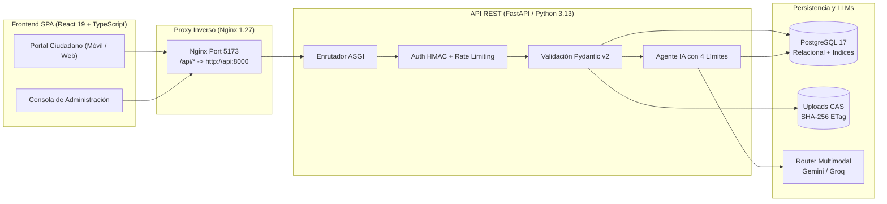

# CIVIA — Especificación Técnica Integral de la API REST y Swagger/OpenAPI

Este documento constituye la especificación canónica y exhaustiva de la interfaz de programación de aplicaciones (**API REST**) de la plataforma **CIVIA (Ciudad Inteligente y Vigilancia Ambiental)**. Detalla los fundamentos arquitectónicos, el marco tecnológico de FastAPI y Pydantic, los patrones de persistencia transaccional con PostgreSQL 17, el protocolo de seguridad basado en tokens criptográficos, la semántica HTTP, la interacción con la interfaz SPA en React 19 y el inventario técnico de los 23 endpoints organizados en Swagger UI.

---

## 1. Fundamentos Arquitectónicos: API REST en CIVIA

Una **API REST (Representational State Transfer)** es un estilo de arquitectura de software para sistemas distribuidos basado en el protocolo sin estado HTTP. En CIVIA, la API REST actúa como el desacoplador central y punto único de verdad entre la interfaz de usuario ciudadana/administrativa y la capa de almacenamiento y procesamiento inteligente:



### Funciones Principales de la API en CIVIA:
1. **Desacoplamiento Estricto:** La interfaz web (React SPA) desconoce completamente la topología de la base de datos o las credenciales de los proveedores de inteligencia artificial. Se comunica únicamente a través de contratos JSON y formularios multipart tipados.
2. **Aplicación Incondicional de Invariantes de Negocio:** Validación geográfica (coordenadas dentro de Santiago de Cali), sanitización de datos personales (PII), verificación de procedencia ética (marcado forzado `is_synthetic = True` mediante SHA-256), y eliminación estricta de metadatos EXIF.
3. **Control Transaccional Hermético:** Todas las operaciones de mutación utilizan transacciones ACID directas en PostgreSQL 17, impidiendo estados corruptos u orfandad de registros y archivos.
4. **Frontera de Seguridad y Confidencialidad:** Impide que información clasificada, tokens de administración, notas internas operativas o trazas técnicas de proveedores upstream sean expuestas al ciudadano.

---

## 2. Marco Tecnológico: FastAPI en Python 3.13

CIVIA utiliza **FastAPI** como núcleo de su backend por las siguientes razones de ingeniería:

* **Arquitectura Asíncrona ASGI de Alto Rendimiento:** Basado en `Starlette` y el servidor `Uvicorn`, FastAPI maneja operaciones concurrentes de entrada/salida (I/O) sin bloquear el bucle de eventos, ofreciendo un desempeño equiparable a plataformas escritas en Go o Node.js.
* **Tipado Estricto y Validación Automática mediante Pydantic v2:** Los esquemas de entrada y salida son modelos tipados en tiempo de ejecución. Cualquier solicitud con campos faltantes, tipos incompatibles o coordenadas fuera de rango es rechazada inmediatamente con código HTTP 422 antes de invocar la lógica de negocio.
* **Autodocumentación Nativa OpenAPI 3.1.0:** A diferencia de frameworks tradicionales donde la documentación se desfasa del código fuente, en FastAPI la especificación técnica se sintetiza automáticamente a partir de los modelos de datos y los decoradores de ruta.
* **Inyección de Dependencias Tipada:** Manejo modular de la autenticación de administradores (`verify_admin_token`), limitadores de tasa (`rate_limiter`) y conexiones a base de datos.

---

## 3. Generación Automática de OpenAPI y Swagger UI

FastAPI genera automáticamente el esquema estandarizado **OpenAPI 3.1.0** inspeccionando las firmas de las funciones, los modelos de Pydantic y los metadatos de los decoradores (`summary`, `description`, `tags`, `response_model`, `status_code`).

### Enlaces de Documentación Interactiva en CIVIA:
* **Swagger UI Interactivo:** `http://localhost:8000/docs`
  Interfaz gráfica basada en Swagger UI que permite explorar interactivamente los contratos, visualizar los modelos de datos y ejecutar solicitudes de prueba mediante la opción *Try it out*.
* **ReDoc (Documentación alternativa):** `http://localhost:8000/redoc`
  Vista orientada a lectura técnica y especificación formal de la API.
* **Especificación OpenAPI cruda en JSON:** `http://localhost:8000/openapi.json`
  Documento JSON canónico que describe todas las rutas, parámetros, esquemas de entrada y respuestas de la plataforma, consumible por generadores de SDKs y clientes automatizados.

---

## 4. Comunicación entre React y FastAPI

La aplicación frontend es una **Single Page Application (PWA)** construida con React 19 y TypeScript. La interacción con la API sigue un modelo limpio y protegido:

1. **Topología de Red y Proxy Inverso:**
   * En desarrollo, Vite redirige las llamadas relativas `/api/*` hacia `http://localhost:8000`.
   * En producción (Docker), Nginx escucha en el puerto `5173`, sirve los archivos estáticos de React y actúa como proxy inverso hacia el contenedor `civia-api:8000` para cualquier solicitud bajo `/api/*` y `/health`.
2. **Tipos de Contenido Manejados:**
   * `application/json`: Empleado en consultas, seguimiento por radicado, invocaciones al asistente de IA y operaciones administrativas.
   * `multipart/form-data`: Empleado exclusivamente en `POST /api/reports` para transferir simultáneamente campos de texto (`title`, `description`, `latitude`, `longitude`, `address_hint`, etc.) y el flujo binario de la fotografía (`photo`).
3. **Manejo de Errores Normalizado:**
   * La capa de cliente de React intercepta respuestas no exitosas (códigos 4xx y 5xx), extrayendo el mensaje sanitizado del campo `{ "detail": "..." }` para presentarlo amigablemente al ciudadano sin divulgar detalles internos ni excepciones técnicas.

---

## 5. Persistencia y Consultas Directas a PostgreSQL 17

CIVIA prescinde deliberadamente de librerías ORM (Object-Relational Mapping) como SQLAlchemy o Tortoise, adoptando **SQL Directo mediante psycopg 3**:

* **Justificación de Diseño:** Máxima predictibilidad del plan de ejecución, eliminación de consultas N+1 encubiertas, control granular sobre bloqueos (`SELECT ... FOR UPDATE`), soporte nativo para `checked_commit` con temporizadores de cancelación y aislamiento estricto de transacciones.
* **Seguridad contra SQL Injection:** El 100% de las consultas SQL emplean sentencias parametrizadas con marcadores de posición (`%s` o composiciones `psycopg.sql.Identifier`), impidiendo cualquier concatenación insegura de cadenas.
* **Estructura Normalizada de Tablas:**
  * `reports`: Almacena la entidad principal de los incidentes viales y ambientales.
  * `report_events`: Ledger de auditoría que registra de forma inmutable cada hito en el ciclo de vida del reporte (creación, confirmación, análisis IA, cambio de estado, notas).
  * `pending_approvals`: Cola de solicitudes de modificación crítica generadas por el agente agéntico que exigen resolución humana calificada.
  * `admin_notifications`: Bandeja de eventos internos para los operadores del sistema.
  * `operation_records` / `operation_intents`: Registro durable para idempotencia de operaciones agénticas y recuperación transaccional ante fallos de red.

---

## 6. Integración del Asistente Agéntico de IA

El endpoint `POST /api/agent/query` permite a ciudadanos y operadores dialogar en lenguaje natural con el sistema. A diferencia de bots conversacionales opacos o sistemas RAG convencionales, CIVIA utiliza un **Agente Genuino de Llamada a Herramientas (Tool Calling)**:

### Los Cuatro Límites Efectivos:
1. **Límite de Vueltas (Iterations):** Control estricto (`AGENT_MAX_ITERATIONS = 5`). El ciclo de razonamiento del LLM no puede encadenar herramientas de forma indefinida.
2. **Límite de Tokens (Budget Tracker):** Reserva y medición previa (`AGENT_MAX_TOKENS = 6000`). Previene agotamiento de cuota y costos imprevistos.
3. **Límite de Tiempo (Timeout / Deadlines):** Supervisor de concurrencia con `ThreadPoolExecutor`. Si una herramienta o consulta SQL supera el deadline, se cancela activamente el backend en PostgreSQL y se previene cualquier escritura tardía.
4. **Aprobación Humana Obligatoria (Human-in-the-Loop):** La IA tiene **estrictamente prohibida la escritura directa en la base de datos**. Cuando el agente determina que se debe actualizar un reporte, únicamente puede invocar la herramienta tipada `proponer_actualizacion_critica`, la cual inserta una solicitud en `pending_approvals` en estado `PENDING`. Solo un operador humano con `ADMIN_TOKEN` puede autorizar o rechazar la acción.

---

## 7. Semántica de Métodos HTTP en CIVIA

| Método | Semántica y Uso en CIVIA | Idempotencia |
|---|---|---|
| **`GET`** | Consulta de recursos (reportes, estadísticas, eventos, fotos, métricas de observabilidad). No produce efectos secundarios ni muta el estado del sistema. | **Sí** |
| **`POST`** | Creación de nuevos recursos (`/api/reports`), envío de consultas complejas al agente (`/api/agent/query`), inyección de fallas y operaciones administrativas críticas. | **No** (salvo con `idempotency_key`) |
| **`PATCH`** | Modificación parcial de un recurso existente (`/api/reports/{id}/confirm`, `/api/reports/{id}/status`, marcado de notificaciones leídas). Actualiza únicamente los campos autorizados. | **Sí** (aplicado al mismo estado objetivo) |

---

## 8. Códigos de Estado HTTP Utilizados

| Código HTTP | Nombre Estándar | Significado Específico en CIVIA |
|---|---|---|
| **`200 OK`** | Solicitud exitosa | La operación de consulta, actualización o análisis concluyó satisfactoriamente. Retorna el payload esperado. |
| **`201 Created`** | Recurso creado | El reporte ciudadano fue creado e insertado exitosamente en PostgreSQL 17. Retorna el objeto del reporte con su nuevo radicado (`tracking_code`). |
| **`304 Not Modified`** | No modificado | Validación de caché HTTP en la entrega de fotografías (`GET .../photo`). El cliente envió `If-None-Match` con el ETag vigente y no se transfieren bytes innecesarios. |
| **`400 Bad Request`** | Solicitud errónea | Parámetro con formato inválido, coordenadas fuera del perímetro de Santiago de Cali o violación de regla de negocio. |
| **`401 Unauthorized`** | No autorizado | Falta la cabecera `X-Admin-Token` o el secreto proporcionado no coincide con el token administrativo configurado en el servidor. |
| **`403 Forbidden`** | Prohibido | Intento de modificar un reporte cerrado, token expirado o intento de mutación administrativa sin aprobación humana requerida. |
| **`404 Not Found`** | No encontrado | El UUID del reporte, el radicado ciudadano (`tracking_code`) o la notificación solicitada no existen en la base de datos. |
| **`409 Conflict`** | Conflicto | Conflicto de idempotencia (reutilización de clave de idempotencia con payload diferente) o colisión de estado transaccional. |
| **`422 Unprocessable Entity`** | Entidad no procesable | Error de validación de esquemas Pydantic v2. Indica parámetros faltantes, tipos de datos erróneos o violaciones estructurales de los esquemas. |
| **`429 Too Many Requests`** | Demasiadas solicitudes | Límite de tasa por IP superado en endpoints públicos (`rate_limiter`) o simulación de saturación de cuota en proveedores de IA upstream. |
| **`500 Internal Server Error`** | Error interno del servidor | Fallo inesperado en el backend. La respuesta es sanitizada automáticamente para no revelar trazas técnicas, rutas del servidor ni nombres de proveedores. |
| **`503 Service Unavailable`** | Servicio no disponible | La base de datos PostgreSQL no se encuentra accesible o todos los proveedores multimodales de la cadena de contingencia han fallado. |

---

## 9. Seguridad: Endpoints Públicos vs. Protegidos

CIVIA implementa el principio de mínimo privilegio separando taxativamente las operaciones ciudadanas abiertas de las consolas operativas:

```mermaid
flowchart TD
    Req[Solicitud HTTP Entrante] --> IsAdmin{¿Ruta /api/admin/* o mutación crítica?}
    IsAdmin -- No (Público) --> RateLimit[Verificar Límite de Tasa por IP\n(Sliding Window)]
    RateLimit -- Superado --> Err429[HTTP 429 Too Many Requests]
    RateLimit -- Permitido --> ExecPublic[Ejecutar Lógica de Negocio Ciudadana]

    IsAdmin -- Sí (Protegido) --> CheckToken{¿Cabecera X-Admin-Token presente?}
    CheckToken -- No --> Err401[HTTP 401 Unauthorized\nToken Requerido]
    CheckToken -- Sí --> HMAC[Comparación en Tiempo Constante\nhmac.compare_digest]
    HMAC -- No coincide --> Err401
    HMAC -- Coincide --> ExecAdmin[Ejecutar Operación Administrativa]
```

### Operaciones Públicas (Sin Autenticación Requerida):
* `GET /health`
* `GET /api/reports/stats`
* `GET /api/reports`
* `GET /api/reports/{id}`
* `GET /api/reports/by-code/{tracking_code}`
* `GET /api/reports/{id}/photo`
* `GET /api/reports/{id}/events`
* `GET /api/reports/by-code/{tracking_code}/events`
* `POST /api/reports`
* `POST /api/reports/{id}/analyze`
* `PATCH /api/reports/{id}/confirm`
* `POST /api/agent/query`

### Operaciones Protegidas (Exigen `X-Admin-Token`):
Cualquier endpoint bajo el prefijo `/api/admin/*`, la modificación operativa de estados (`PATCH /api/reports/{id}/status`) y la reconciliación privada de operaciones agénticas exige la cabecera:
```http
X-Admin-Token: <SECRETO_CONFIGURADO_EN_ENV>
```
La verificación utiliza `hmac.compare_digest` para neutralizar de forma absoluta ataques de temporización (*timing attacks*).

---

## 10. Guía de Uso de Swagger UI (`/docs`)

Swagger UI permite inspeccionar y probar la API de forma interactiva en entornos de desarrollo y evaluación académica.

### Instrucciones de Demostración Local:
1. Abra su navegador en: `http://localhost:8000/docs`
2. Verifique la cabecera del documento: observe el título oficial de la plataforma, la versión `1.0.0` y la descripción del sistema.
3. Despliegue cualquiera de las 8 categorías temáticas (*tags*).
4. Para probar un endpoint público (por ejemplo, `GET /health` o `GET /api/reports/stats`):
   * Haga clic en la tarjeta del endpoint para expandirla.
   * Haga clic en el botón **"Try it out"**.
   * Presione el botón azul **"Execute"**.
   * Inspeccione el código de respuesta (`200`), las cabeceras devueltas y el payload JSON estructurado.
5. Para probar un endpoint protegido (por ejemplo, `GET /api/admin/observability`):
   * Al pulsar **"Execute"** sin configurar credenciales, observe la respuesta inmediata con código `401 Unauthorized` (`detail: Token de administración no configurado o ausente`).
   * Para autorizar la llamada dentro de Swagger UI, proporcione el valor del `ADMIN_TOKEN` en el campo de parámetro de cabecera `X-Admin-Token`.

---

## 11. Inventario Exhaustivo de Endpoints (Los 23 Métodos)

### Tag 1: Salud del sistema

#### 1. `GET /health`
* **Finalidad:** Comprobar la disponibilidad general de la API REST, versión activa y estado de la conexión transaccional con PostgreSQL 17.
* **Parámetros:** Ninguno.
* **Cuerpo:** Vacío.
* **Autenticación:** Pública.
* **Respuesta Exitosa (200 OK):**
  ```json
  {
    "status": "ok",
    "phase": "mvp",
    "db": {
      "connected": true,
      "schema_ready": true
    }
  }
  ```
* **Códigos de Error:** `503 Service Unavailable` si la base de datos se encuentra desconectada.
* **Ejemplo cURL:**
  ```bash
  curl -s http://localhost:8000/health
  ```
* **Consumo en Frontend:** `src/App.tsx` en el indicador de estado de conexión del pie de página y comprobación inicial de disponibilidad.

---

### Tag 2: Reportes ciudadanos

#### 2. `GET /api/reports/stats`
* **Finalidad:** Obtener métricas consolidadas de incidentes urbanos registrados en el municipio de Cali para cuadros de mando.
* **Parámetros:** Ninguno.
* **Cuerpo:** Vacío.
* **Autenticación:** Pública.
* **Respuesta Exitosa (200 OK):**
  ```json
  {
    "total_reports": 10,
    "by_category": {
      "HUECO": 3,
      "BASURAS": 3,
      "TALA": 2,
      "QUEMA": 1,
      "OTRO": 1
    },
    "by_status": {
      "CONFIRMED": 10
    }
  }
  ```
* **Códigos de Error:** `500 Internal Server Error`.
* **Ejemplo cURL:**
  ```bash
  curl -s http://localhost:8000/api/reports/stats
  ```
* **Consumo en Frontend:** Pestaña "Mapa y Reportes" para los contadores superiores de balance de incidentes.

#### 3. `POST /api/reports`
* **Finalidad:** Registrar un nuevo incidente vial o ambiental aportando evidencia fotográfica y coordenadas geográficas.
* **Parámetros:** Formulario multipart (`multipart/form-data`):
  * `title` (str, 3..120 car.): Título descriptivo.
  * `description` (str, 5..1000 car.): Detalle del incidente.
  * `latitude` (float, -90..90): Latitud geográfica (perímetro de Cali).
  * `longitude` (float, -180..180): Longitud geográfica (perímetro de Cali).
  * `address_hint` (str, opcional): Dirección referencial o nomenclatura.
  * `comuna` (str, opcional): Comuna de Santiago de Cali (ej. "Comuna 3").
  * `neighborhood` (str, opcional): Barrio de ubicación.
  * `photo` (file, obligatorio): Archivo de imagen JPEG, PNG o WebP.
  * `is_synthetic` (bool, opcional, default=False): Indicador de muestra de prueba.
  * `auto_analyze` (bool, opcional, default=True): Solicitar diagnóstico preliminar de IA.
* **Autenticación:** Pública (protegido por limitador de tasa por IP).
* **Respuesta Exitosa (201 Created):**
  ```json
  {
    "id": "e6a2b847-cf42-4f0e-b7d8-f80e0cdbf3a1",
    "tracking_code": "CIV-2026-01D52188B9",
    "title": "Bache en Calle 5 con Carrera 10",
    "description": "Hueco pronunciado sobre el carril derecho",
    "category": "HUECO",
    "severity": "ALTA",
    "status": "PENDING_ANALYSIS",
    "latitude": 3.4428,
    "longitude": -76.5361,
    "address_hint": "Calle 5 con Carrera 10",
    "comuna": "Comuna 3",
    "neighborhood": "San Antonio",
    "photo_url": "/api/reports/e6a2b847-cf42-4f0e-b7d8-f80e0cdbf3a1/photo",
    "is_synthetic": false,
    "created_at": "2026-11-06T08:15:00Z"
  }
  ```
* **Códigos de Error:** `400 Bad Request` (archivo corrupto o coordenadas fuera de Cali), `422 Unprocessable Entity`, `429 Too Many Requests`.
* **Ejemplo cURL:**
  ```bash
  curl -X POST http://localhost:8000/api/reports \
    -F "title=Bache en la calzada" \
    -F "description=Hueco en carril izquierdo que genera peligro" \
    -F "latitude=3.4516" \
    -F "longitude=-76.5320" \
    -F "address_hint=Avenida 6N con Calle 18" \
    -F "photo=@foto_calle.jpg;type=image/jpeg"
  ```
* **Consumo en Frontend:** Pestaña "Nuevo Reporte" (`handleSubmitReport`).

#### 4. `POST /api/reports/{report_id}/analyze`
* **Finalidad:** Ejecutar o reintentar el análisis multimodal con IA para un reporte ya persistido en base de datos.
* **Parámetros:** `report_id` (UUID en ruta).
* **Cuerpo:** Vacío.
* **Autenticación:** Pública.
* **Respuesta Exitosa (200 OK):** Objeto `ReportPublicResponse` con los campos `ai_diagnosis`, `category`, `severity` y sugerencia de priorización actualizados.
* **Códigos de Error:** `404 Not Found`, `503 Service Unavailable`.
* **Ejemplo cURL:**
  ```bash
  curl -X POST http://localhost:8000/api/reports/e6a2b847-cf42-4f0e-b7d8-f80e0cdbf3a1/analyze
  ```
* **Consumo en Frontend:** Invocado automáticamente tras el alta de reporte si `auto_analyze=true`, o mediante botón de reintento.

#### 5. `GET /api/reports`
* **Finalidad:** Listar reportes registrados en PostgreSQL de forma paginada y con filtros multidimensionales.
* **Parámetros de Consulta (Query):**
  * `skip` (int, default=0): Número de registros a omitir.
  * `limit` (int, default=50, max=100): Cantidad máxima de registros por página.
  * `category` (str, opcional): Filtrar por categoría (`HUECO`, `BASURAS`, `TALA`, `QUEMA`, `OTRO`).
  * `severity` (str, opcional): Filtrar por severidad (`BAJA`, `MEDIA`, `ALTA`, `CRITICA`).
  * `status` (str, opcional): Filtrar por estado (`PENDING_ANALYSIS`, `CONFIRMED`, `IN_REVIEW`, `RESOLVED`, `REJECTED`).
  * `comuna` (str, opcional): Filtrar por comuna de Cali.
  * `q` (str, opcional): Término de búsqueda de texto libre en título, descripción o dirección.
  * `lat`, `lon`, `radius_km` (float, opcional): Filtro geoespacial radial utilizando fórmula de Haversine.
* **Autenticación:** Pública.
* **Respuesta Exitosa (200 OK):**
  ```json
  {
    "total": 10,
    "page": 1,
    "limit": 50,
    "items": [
      {
        "id": "e6a2b847-cf42-4f0e-b7d8-f80e0cdbf3a1",
        "tracking_code": "CIV-2026-01D52188B9",
        "title": "Bache en Calle 5 con Carrera 10",
        "category": "HUECO",
        "severity": "ALTA",
        "status": "CONFIRMED",
        "latitude": 3.4428,
        "longitude": -76.5361,
        "created_at": "2026-11-06T08:15:00Z"
      }
    ]
  }
  ```
* **Códigos de Error:** `422 Unprocessable Entity`.
* **Ejemplo cURL:**
  ```bash
  curl -s "http://localhost:8000/api/reports?category=HUECO&limit=10"
  ```
* **Consumo en Frontend:** Pestaña "Mapa y Reportes" (`fetchReports`).

#### 6. `GET /api/reports/by-code/{tracking_code}`
* **Finalidad:** Consultar la información pública y estado de un reporte utilizando su código de radicado oficial.
* **Parámetros:** `tracking_code` (str en ruta, ej. "CIV-2026-DEMO0001").
* **Autenticación:** Pública.
* **Respuesta Exitosa (200 OK):** Objeto `ReportPublicResponse` con datos públicos del reporte.
* **Códigos de Error:** `404 Not Found` si el radicado no existe.
* **Ejemplo cURL:**
  ```bash
  curl -s http://localhost:8000/api/reports/by-code/CIV-2026-DEMO0001
  ```
* **Consumo en Frontend:** Pestaña "Seguimiento Radicado" (`handleTrackByCode`).

#### 7. `GET /api/reports/{report_id}`
* **Finalidad:** Obtener los datos públicos detallados de un reporte a partir de su UUID.
* **Parámetros:** `report_id` (UUID en ruta).
* **Autenticación:** Pública.
* **Respuesta Exitosa (200 OK):** Objeto `ReportPublicResponse`.
* **Códigos de Error:** `404 Not Found`.
* **Ejemplo cURL:**
  ```bash
  curl -s http://localhost:8000/api/reports/e6a2b847-cf42-4f0e-b7d8-f80e0cdbf3a1
  ```
* **Consumo en Frontend:** Selección de marcador en el mapa interactivo.

#### 8. `PATCH /api/reports/{report_id}/confirm`
* **Finalidad:** Permitir al ciudadano confirmar o corregir la categoría y severidad del incidente tras la evaluación de la IA. Transiciona el estado a `CONFIRMED`.
* **Parámetros:** `report_id` (UUID en ruta).
* **Cuerpo (JSON):**
  ```json
  {
    "category": "HUECO",
    "severity": "ALTA",
    "citizen_feedback": "Confirmo que es un bache de gran profundidad"
  }
  ```
* **Autenticación:** Pública (requiere token de edición emitido al crear el reporte o radicado válido).
* **Respuesta Exitosa (200 OK):** Objeto `ReportPublicResponse` con estado `CONFIRMED`.
* **Códigos de Error:** `400 Bad Request`, `404 Not Found`, `422 Unprocessable Entity`.
* **Ejemplo cURL:**
  ```bash
  curl -X PATCH http://localhost:8000/api/reports/e6a2b847-cf42-4f0e-b7d8-f80e0cdbf3a1/confirm \
    -H "Content-Type: application/json" \
    -d '{"category": "HUECO", "severity": "ALTA"}'
  ```
* **Consumo en Frontend:** Tarjeta de confirmación tras registrar un nuevo reporte.

---

### Tag 3: Fotografías y evidencias

#### 9. `GET /api/reports/{report_id}/photo`
* **Finalidad:** Descargar y visualizar el archivo de evidencia fotográfica almacenado en disco (Content-Addressed Storage).
* **Parámetros:**
  * `report_id` (UUID en ruta).
  * `v` (str, opcional en query): Versión/hash para busteo de caché.
* **Autenticación:** Pública.
* **Cabeceras de Respuesta Destacadas:**
  * `Content-Type`: `image/jpeg` o `image/png`.
  * `ETag`: Hash SHA-256 del archivo.
  * `Cache-Control`: `public, max-age=86400, stale-while-revalidate=3600`.
  * `Content-Security-Policy`: `default-src 'none'; img-src 'self'`.
  * `X-Content-Type-Options`: `nosniff`.
* **Respuesta Exitosa (200 OK / 304 Not Modified):** Flujo de bytes de la imagen. Si el cliente incluye `If-None-Match` con el ETag coincidente, devuelve HTTP 304 sin cuerpo.
* **Códigos de Error:** `404 Not Found`.
* **Ejemplo cURL:**
  ```bash
  curl -i http://localhost:8000/api/reports/e6a2b847-cf42-4f0e-b7d8-f80e0cdbf3a1/photo
  ```
* **Consumo en Frontend:** Componente de previsualización de evidencias en Mapa y Seguimiento (``).

---

### Tag 4: Seguimiento y trazabilidad

#### 10. `GET /api/reports/{report_id}/events`
* **Finalidad:** Obtener la cronología pública y transparente de eventos de trazabilidad de un reporte por UUID.
* **Parámetros:** `report_id` (UUID en ruta).
* **Autenticación:** Pública.
* **Respuesta Exitosa (200 OK):**
  ```json
  [
    {
      "id": "11111111-2222-3333-4444-555555555555",
      "report_id": "e6a2b847-cf42-4f0e-b7d8-f80e0cdbf3a1",
      "event_type": "CREATED",
      "summary": "Reporte registrado por el ciudadano",
      "actor_type": "CITIZEN",
      "created_at": "2026-11-06T08:15:00Z"
    },
    {
      "id": "22222222-3333-4444-5555-666666666666",
      "report_id": "e6a2b847-cf42-4f0e-b7d8-f80e0cdbf3a1",
      "event_type": "ASSIGNED",
      "summary": "Asignado a: Secretaría de Infraestructura de Cali",
      "actor_type": "ADMIN",
      "created_at": "2026-11-06T08:20:00Z"
    }
  ]
  ```
* **Códigos de Error:** `404 Not Found`.
* **Ejemplo cURL:**
  ```bash
  curl -s http://localhost:8000/api/reports/e6a2b847-cf42-4f0e-b7d8-f80e0cdbf3a1/events
  ```
* **Consumo en Frontend:** Línea de tiempo visual en el panel de detalle del reporte.

#### 11. `GET /api/reports/by-code/{tracking_code}/events`
* **Finalidad:** Consultar la línea de tiempo histórica del reporte utilizando el número de radicado ciudadano.
* **Parámetros:** `tracking_code` (str en ruta).
* **Autenticación:** Pública.
* **Respuesta Exitosa (200 OK):** Lista de objetos `ReportEventPublic`.
* **Códigos de Error:** `404 Not Found`.
* **Ejemplo cURL:**
  ```bash
  curl -s http://localhost:8000/api/reports/by-code/CIV-2026-DEMO0001/events
  ```
* **Consumo en Frontend:** Pestaña "Seguimiento Radicado" (`handleTrackByCode`).

---

### Tag 5: Asistente ciudadano e IA

#### 12. `POST /api/agent/query`
* **Finalidad:** Procesar consultas conversacionales en lenguaje natural con el agente inteligente de CIVIA mediante llamadas tipadas a herramientas de base de datos.
* **Parámetros:** Ninguno en ruta o query.
* **Cuerpo (JSON):**
  ```json
  {
    "query": "¿Cuántos reportes de baches confirmados hay registrados en la Comuna 3?",
    "history": []
  }
  ```
* **Autenticación:** Pública (protegido por limitador de tasa por IP).
* **Respuesta Exitosa (200 OK):**
  ```json
  {
    "answer": "Actualmente se registran 2 incidentes de tipo Hueco confirmados en la Comuna 3 de Cali.",
    "tools_called": [
      {
        "name": "consultar_reportes",
        "args": {
          "categoria": "HUECO",
          "comuna": "Comuna 3"
        }
      }
    ],
    "iterations": 2,
    "model_used": "gemini-3.8-flash",
    "prompt_tokens": 820,
    "completion_tokens": 145,
    "total_tokens": 965,
    "execution_time_seconds": 1.24
  }
  ```
* **Códigos de Error:** `422 Unprocessable Entity`, `429 Too Many Requests`, `503 Service Unavailable`.
* **Ejemplo cURL:**
  ```bash
  curl -X POST http://localhost:8000/api/agent/query \
    -H "Content-Type: application/json" \
    -d '{"query": "¿Qué incidentes hay en San Antonio?"}'
  ```
* **Consumo en Frontend:** Pestaña "Asistente Ciudadano" (`handleSendAgentQuery`).

#### 13. `GET /api/operations/{operation_id}`
* **Finalidad:** Reconciliar o consultar el estado definitivo de una operación transaccional agéntica con soporte de idempotencia.
* **Parámetros:** `operation_id` (UUID en ruta).
* **Autenticación:** Restringida (requiere token de operación `X-Operation-Token` o `X-Admin-Token`).
* **Respuesta Exitosa (200 OK):**
  ```json
  {
    "operation_id": "4a1b2c3d-e5f6-7a8b-9c0d-1e2f3a4b5c6d",
    "status": "COMMITTED",
    "operation_type": "proponer_actualizacion_critica",
    "created_at": "2026-11-06T08:15:00Z"
  }
  ```
* **Códigos de Error:** `401 Unauthorized`, `404 Not Found`.
* **Ejemplo cURL:**
  ```bash
  curl -s http://localhost:8000/api/operations/4a1b2c3d-e5f6-7a8b-9c0d-1e2f3a4b5c6d \
    -H "X-Admin-Token: <SECRETO>"
  ```
* **Consumo en Frontend:** Reconciliación agéntica y gestión de reintentos en fallas transitorias de red.

---

### Tag 6: Administración y gestión operativa

#### 14. `PATCH /api/reports/{report_id}/status`
* **Finalidad:** Actualizar formalmente el estado operativo de un reporte ciudadano (`CONFIRMED`, `IN_REVIEW`, `RESOLVED`, `REJECTED`).
* **Parámetros:** `report_id` (UUID en ruta).
* **Cuerpo (JSON):**
  ```json
  {
    "status": "RESOLVED",
    "human_approved": true,
    "resolution_notes": "Trabajos de bacheo completados por cuadrilla de infraestructura vial."
  }
  ```
* **Autenticación:** **Protegida (Requiere `X-Admin-Token`)**.
* **Respuesta Exitosa (200 OK):** Objeto `ReportPublicResponse` actualizado.
* **Códigos de Error:** `400 Bad Request`, `401 Unauthorized`, `403 Forbidden`, `404 Not Found`.
* **Ejemplo cURL:**
  ```bash
  curl -X PATCH http://localhost:8000/api/reports/e6a2b847-cf42-4f0e-b7d8-f80e0cdbf3a1/status \
    -H "X-Admin-Token: <ADMIN_TOKEN>" \
    -H "Content-Type: application/json" \
    -d '{"status": "RESOLVED", "human_approved": true, "resolution_notes": "Reparado"}'
  ```
* **Consumo en Frontend:** Pestaña "Administración" (selector de cambio de estado de reporte).

#### 15. `POST /api/admin/seed`
* **Finalidad:** Inicializar o restablecer de forma idempotente los 10 reportes sintéticos de prueba con evidencias fotorrealistas en Cali.
* **Parámetros:** Ninguno.
* **Cuerpo (JSON, opcional):**
  ```json
  {
    "force_reset": false
  }
  ```
* **Autenticación:** **Protegida (Requiere `X-Admin-Token`)**.
* **Respuesta Exitosa (200 OK):**
  ```json
  {
    "status": "ok",
    "message": "Catálogo sintético verificado (10 reportes cargados)",
    "seeded_count": 10
  }
  ```
* **Códigos de Error:** `401 Unauthorized`, `500 Internal Server Error`.
* **Ejemplo cURL:**
  ```bash
  curl -X POST http://localhost:8000/api/admin/seed \
    -H "X-Admin-Token: <ADMIN_TOKEN>"
  ```
* **Consumo en Frontend:** Pestaña "Administración" (botón "Restablecer Datos de Prueba").

#### 16. `GET /api/admin/notifications`
* **Finalidad:** Listar las alertas internas generadas automáticamente ante nuevos reportes ciudadanos o eventos de prueba.
* **Parámetros de Consulta (Query):**
  * `unread_only` (bool, default=false): Filtrar solo no leídas.
  * `scope` (str, opcional): Filtrar por ámbito (`ALL`, `CITIZEN`, `SYNTHETIC`).
* **Autenticación:** **Protegida (Requiere `X-Admin-Token`)**.
* **Respuesta Exitosa (200 OK):**
  ```json
  {
    "total": 5,
    "unread_count": 2,
    "items": [
      {
        "id": "33333333-4444-5555-6666-777777777777",
        "report_id": "e6a2b847-cf42-4f0e-b7d8-f80e0cdbf3a1",
        "tracking_code": "CIV-2026-01D52188B9",
        "title": "Nuevo reporte ciudadano recibido: Bache en Calle 5",
        "category": "HUECO",
        "is_read": false,
        "is_synthetic": false,
        "created_at": "2026-11-06T08:15:00Z"
      }
    ]
  }
  ```
* **Códigos de Error:** `401 Unauthorized`.
* **Ejemplo cURL:**
  ```bash
  curl -s http://localhost:8000/api/admin/notifications \
    -H "X-Admin-Token: <ADMIN_TOKEN>"
  ```
* **Consumo en Frontend:** Pestaña "Administración" (Bandeja de Entrada de Alertas).

#### 17. `PATCH /api/admin/notifications/{notification_id}/read`
* **Finalidad:** Marcar una notificación interna individual como leída.
* **Parámetros:** `notification_id` (UUID en ruta).
* **Autenticación:** **Protegida (Requiere `X-Admin-Token`)**.
* **Respuesta Exitosa (200 OK):**
  ```json
  {
    "status": "ok",
    "id": "33333333-4444-5555-6666-777777777777",
    "is_read": true
  }
  ```
* **Códigos de Error:** `401 Unauthorized`, `404 Not Found`.
* **Ejemplo cURL:**
  ```bash
  curl -X PATCH http://localhost:8000/api/admin/notifications/33333333-4444-5555-6666-777777777777/read \
    -H "X-Admin-Token: <ADMIN_TOKEN>"
  ```
* **Consumo en Frontend:** Pestaña "Administración" (botón de confirmación de lectura).

#### 18. `POST /api/admin/notifications/mark-all-read`
* **Finalidad:** Marcar simultáneamente como leídas todas las notificaciones pendientes en la bandeja administrativa.
* **Parámetros:** Ninguno.
* **Autenticación:** **Protegida (Requiere `X-Admin-Token`)**.
* **Respuesta Exitosa (200 OK):**
  ```json
  {
    "status": "ok",
    "marked_count": 4
  }
  ```
* **Códigos de Error:** `401 Unauthorized`.
* **Ejemplo cURL:**
  ```bash
  curl -X POST http://localhost:8000/api/admin/notifications/mark-all-read \
    -H "X-Admin-Token: <ADMIN_TOKEN>"
  ```
* **Consumo en Frontend:** Pestaña "Administración" (botón "Marcar todas como leídas").

#### 19. `POST /api/admin/reports/{report_id}/management`
* **Finalidad:** Asignar una dependencia municipal responsable y registrar notas de seguimiento públicas o notas internas confidenciales.
* **Parámetros:** `report_id` (UUID en ruta).
* **Cuerpo (JSON):**
  ```json
  {
    "assigned_entity": "Secretaría de Infraestructura de Cali",
    "public_note": "Cuadrilla de bacheo programada para intervención el día lunes.",
    "internal_note": "Coordinado internamente con ingeniero de turno, orden de trabajo #4412."
  }
  ```
* **Autenticación:** **Protegida (Requiere `X-Admin-Token`)**.
* **Respuesta Exitosa (200 OK):** Objeto `ReportPublicResponse` actualizado. Las notas internas se registran en `report_events` bajo etiqueta confidencial y no se retornan en las vistas ciudadanas.
* **Códigos de Error:** `400 Bad Request`, `401 Unauthorized`, `404 Not Found`.
* **Ejemplo cURL:**
  ```bash
  curl -X POST http://localhost:8000/api/admin/reports/e6a2b847-cf42-4f0e-b7d8-f80e0cdbf3a1/management \
    -H "X-Admin-Token: <ADMIN_TOKEN>" \
    -H "Content-Type: application/json" \
    -d '{"assigned_entity": "Dagma", "public_note": "Caso remitido a botánica urbana"}'
  ```
* **Consumo en Frontend:** Pestaña "Administración" (formulario de gestión de despacho).

---

### Tag 7: Aprobaciones humanas

#### 20. `GET /api/admin/approvals`
* **Finalidad:** Listar las solicitudes de modificación crítica generadas por el agente agéntico que requieren resolución humana obligatoria.
* **Parámetros de Consulta (Query):**
  * `status` (str, opcional, default="PENDING"): Filtrar por estado (`PENDING`, `APPROVED`, `REJECTED`).
* **Autenticación:** **Protegida (Requiere `X-Admin-Token`)**.
* **Respuesta Exitosa (200 OK):**
  ```json
  [
    {
      "id": "77777777-8888-9999-aaaa-bbbbbbbbbbbb",
      "report_id": "e6a2b847-cf42-4f0e-b7d8-f80e0cdbf3a1",
      "tracking_code": "CIV-2026-01D52188B9",
      "action_type": "UPDATE_STATUS",
      "current_value": "CONFIRMED",
      "proposed_value": "IN_REVIEW",
      "reasoning": "El ciudadano aportó nueva evidencia sobre avance de grietas que justifica escalamiento.",
      "status": "PENDING",
      "created_at": "2026-11-06T08:18:00Z"
    }
  ]
  ```
* **Códigos de Error:** `401 Unauthorized`.
* **Ejemplo cURL:**
  ```bash
  curl -s http://localhost:8000/api/admin/approvals \
    -H "X-Admin-Token: <ADMIN_TOKEN>"
  ```
* **Consumo en Frontend:** Pestaña "Administración" (Panel de Aprobaciones Pendientes).

#### 21. `POST /api/admin/approvals/{approval_id}/decide`
* **Finalidad:** Aprobar o rechazar de forma atómica y de un solo uso una propuesta de cambio de estado generada por la IA.
* **Parámetros:** `approval_id` (UUID en ruta).
* **Cuerpo (JSON):**
  ```json
  {
    "decision": "APPROVED",
    "operator_notes": "Verificación en terreno confirma necesidad de escalamiento."
  }
  ```
* **Autenticación:** **Protegida (Requiere `X-Admin-Token`)**.
* **Respuesta Exitosa (200 OK):**
  ```json
  {
    "status": "ok",
    "approval_id": "77777777-8888-9999-aaaa-bbbbbbbbbbbb",
    "decision": "APPROVED",
    "applied_at": "2026-11-06T08:22:00Z"
  }
  ```
* **Códigos de Error:** `400 Bad Request`, `401 Unauthorized`, `404 Not Found`, `409 Conflict` (si ya fue decidida previamente).
* **Ejemplo cURL:**
  ```bash
  curl -X POST http://localhost:8000/api/admin/approvals/77777777-8888-9999-aaaa-bbbbbbbbbbbb/decide \
    -H "X-Admin-Token: <ADMIN_TOKEN>" \
    -H "Content-Type: application/json" \
    -d '{"decision": "APPROVED"}'
  ```
* **Consumo en Frontend:** Pestaña "Administración" (botones "Aprobar" / "Rechazar").

---

### Tag 8: Observabilidad y resiliencia

#### 22. `GET /api/admin/observability`
* **Finalidad:** Monitorear el estado técnico de la plataforma: cadena activa de proveedores de IA, interruptores de circuito (*circuit breakers*), latencias P50/P90 y trazas de auditoría sanitizadas sin secretos.
* **Parámetros:** Ninguno.
* **Autenticación:** **Protegida (Requiere `X-Admin-Token`)**.
* **Respuesta Exitosa (200 OK):**
  ```json
  {
    "provider_chain": [
      {"provider": "gemini", "model": "gemini-3.8-flash", "state": "CLOSED"},
      {"provider": "groq", "model": "qwen/qwen3.8-27b", "state": "CLOSED"},
      {"provider": "gemini_tertiary", "model": "gemini-3.5-flash-lite", "state": "CLOSED"}
    ],
    "circuit_breakers": {
      "gemini_primary": {"status": "HEALTHY", "failures": 0},
      "groq": {"status": "HEALTHY", "failures": 0}
    },
    "metrics": {
      "latency_p50_ms": 1150,
      "latency_p90_ms": 2840,
      "total_ai_calls": 24
    },
    "recent_traces": []
  }
  ```
* **Códigos de Error:** `401 Unauthorized`.
* **Ejemplo cURL:**
  ```bash
  curl -s http://localhost:8000/api/admin/observability \
    -H "X-Admin-Token: <ADMIN_TOKEN>"
  ```
* **Consumo en Frontend:** Pestaña "Administración" (Panel de Telemetría y Resiliencia).

#### 23. `POST /api/admin/fault-injection`
* **Finalidad:** Inyectar fallas sintéticas controladas en caliente para pruebas y demostraciones de resiliencia de la conmutación entre proveedores (`429`, `503`, `TIMEOUT`, `INVALID_JSON`, `TOTAL`, `RESET`).
* **Parámetros:** Ninguno.
* **Cuerpo (JSON):**
  ```json
  {
    "fault_type": "429",
    "target_provider": "gemini_primary",
    "duration_seconds": 60
  }
  ```
* **Autenticación:** **Protegida (Requiere `X-Admin-Token`)**.
* **Respuesta Exitosa (200 OK):**
  ```json
  {
    "status": "ok",
    "message": "Falla sintética '429' inyectada en proveedor 'gemini_primary' por 60 segundos."
  }
  ```
* **Códigos de Error:** `400 Bad Request` (tipo de falla no reconocido), `401 Unauthorized`.
* **Ejemplo cURL:**
  ```bash
  curl -X POST http://localhost:8000/api/admin/fault-injection \
    -H "X-Admin-Token: <ADMIN_TOKEN>" \
    -H "Content-Type: application/json" \
    -d '{"fault_type": "429", "target_provider": "gemini_primary"}'
  ```
* **Consumo en Frontend:** Pestaña "Administración" (Simulador de Contingencias en vivo).

---

## 12. Seguridad y Buenas Prácticas en Swagger UI

Al interactuar con Swagger UI (`http://localhost:8000/docs`), se deben observar las siguientes directrices de seguridad operacional:

1. **Swagger UI no concede autorización automática:** La interfaz interactiva es un visor web estático. Si se invoca un endpoint protegido sin proporcionar el `ADMIN_TOKEN` en la cabecera correspondiente, el backend rechazará incondicionalmente la petición con `HTTP 401`.
2. **Precauciones con "Try it out":** Los endpoints de mutación (`POST /api/reports`, `PATCH .../status`, etc.) ejecutan operaciones **reales** contra la base de datos PostgreSQL conectada. Para pruebas de demostración, emplee siempre las muestras oficiales del catálogo sintético o los radicados reservados (`CIV-2026-DEMO0001` a `DEMO0010`).
3. **No ingresar tokens productivos en navegadores compartidos:** El `ADMIN_TOKEN` debe tratarse como una credencial sensible de alta seguridad. En demostraciones públicas, se recomienda utilizar el token generado aleatoriamente por el script de arranque para esa sesión.
4. **Protección contra Fuerza Bruta y DoS:** La API cuenta con limitador de tasa activo por IP (`RateLimiter`). Ejecutar solicitudes masivas consecutivas mediante "Try it out" activará la protección de tasa devolviendo `HTTP 429`.
