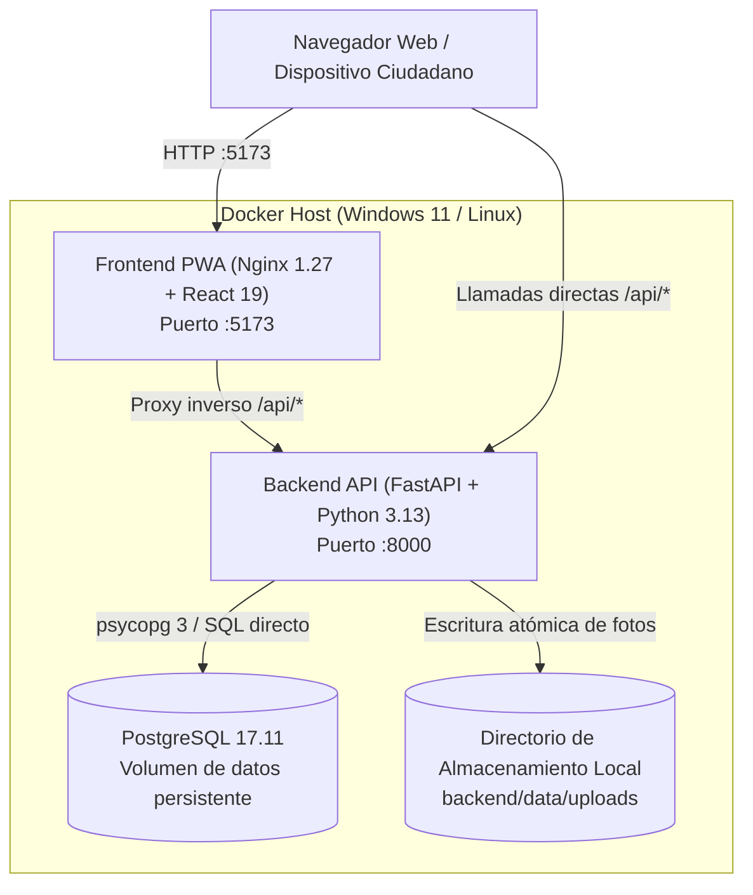

# CIVIA — Arquitectura de Despliegue y Análisis de Opciones Cloud

**Proyecto Académico de Ingeniería de Aplicaciones con IA — Universidad Cooperativa de Colombia**  
**Equipo:** Stefania Córdoba y Sebastian Espinosa (Momento Evaluativo 2)  
**Entorno Oficial:** Local Docker Orquestado (`main`)

Este documento analiza la topología de despliegue de CIVIA tanto en entornos locales controlados como en infraestructuras de computación en la nube.

---

## 1. Topología Local Orquestada (Docker Compose)

El entorno de ejecución estándar se compone de tres servicios intercomunicados en una red puente aislada (`civia_civia_net`):

### Características de Seguridad y Resiliencia
- **Aislamiento de red:** La base de datos PostgreSQL no expone puertos al exterior en producción; solo es accesible por el contenedor API dentro de la red puente interna `civia_net`.
- **Fail-closed en arranque:** La API valida el `ADMIN_TOKEN` con CSPRNG; si es débil, predecible o ausente, aborta el inicio inmediatamente impidiendo accesos no autorizados.
- **Almacenamiento inmutable Content-Addressed Storage (CAS):**
  - **Catálogo sintético oficial:** Las evidencias fotográficas se direccionan de forma determinista e inmutable mediante el patrón `synthetic_{code}_{sha[:16]}.jpg`. Esto provee idempotencia absoluta durante el sembrado (`seed`), previniendo archivos huérfanos o duplicados.
  - **Evidencias ciudadanas:** Toda fotografía se valida por *magic bytes* reales, se re-serializa con Pillow eliminando metadatos EXIF/GPS para proteger la privacidad ciudadana y se persiste de forma inmutable con su hash SHA-256 verificado.
- **Versionado y caché HTTP estricto:** Las URLs de fotografías incorporan el hash del archivo `?v={sha[:16]}` con cabeceras `Cache-Control: public, max-age=31536000, immutable`, ETag estricto y validación condicional `HTTP 304 Not Modified`.
- **Aislamiento anti-XSS:** El endpoint de entrega de imágenes emite cabeceras de seguridad estrictas: `Content-Security-Policy: default-src 'none'; img-src 'self'; style-src 'none'; script-src 'none'` y `X-Content-Type-Options: nosniff`.

---

## 2. Análisis Comparativo de Opciones de Despliegue en la Nube

Para evaluar la viabilidad de publicar CIVIA en una nube pública, se analizaron cinco alternativas comunes:

| Proveedor / Plataforma | Soporte PostgreSQL 17 Persistente | Manejo de Almacenamiento de Imágenes | Costo Mensual Estimado | Factibilidad Académica Inmediata |
|---|---|---|---|---|
| **Render** | Tier gratuito / pago ($7/mes) | Disco efímero en tier gratis (requiere S3 o Render Disk de pago) | $7 – $15 USD | Requiere tarjeta de crédito y configuración externa de S3 |
| **Railway** | Excelente soporte Docker Compose | Requiere Railway Volume o Bucket compatible con S3 | $5 – $10 USD | Requiere suscripción activa de pago |
| **Fly.io** | Soporte de PostgreSQL y volúmenes | Requiere volumen persistente por región | $5 – $12 USD | Requiere registro de método de pago |
| **AWS (ECS + RDS + S3)** | RDS PostgreSQL multi-AZ, S3 para fotos | S3 nativo con URLs presignadas | $35 – $60 USD | Excesivo para evaluación de prototipo académico |
| **GCP (Cloud Run + Cloud SQL)** | Cloud SQL PostgreSQL, Cloud Storage | Cloud Storage con bucket seguro | $25 – $45 USD | Requiere proyecto corporativo o créditos GCP |

---

## 3. Dictamen y Estado Oficial de Despliegue Cloud

> **ESTADO OFICIAL: DESPLIEGUE LOCAL LISTO; URL PÚBLICA PENDIENTE DE INFRAESTRUCTURA**
> 
> **Justificación técnica y académica:**
> 1. **Integridad de datos y privacidad:** CIVIA requiere PostgreSQL 17 con almacenamiento transaccional y persistencia de evidencias fotográficas en disco o bucket seguro. Los tiers gratuitos públicos no garantizan persistencia tras reinicios automáticos de instancias efímeras (*sleep mode*).
> 2. **Reproducibilidad y soberanía evaluativa:** El despliegue local mediante `.\scripts\run.ps1` o `docker compose up --build -d` garantiza que el evaluador disponga del 100% del stack en su entorno sin depender de latencias externas, caídas de cuotas gratuitas en la nube ni expiración de tokens.
> 3. **Cero costos y cero credenciales expuestas:** No se comprometen secretos de infraestructura privada ni se incurre en facturación para la entrega del Momento 2.
> 
> Si la cátedra o institución universitaria provee una cuenta institucional de AWS, GCP o Railway, el archivo `Dockerfile` y `docker-compose.yml` están preparados para desplegarse de manera inmediata.

---

## 4. Documentación de la API REST y Contratos de Servicio
Para consultar el catálogo exhaustivo de los 23 endpoints REST de CIVIA, sus parámetros, modelos de datos Pydantic v2, códigos de respuesta HTTP y directrices de seguridad, consulte el documento canónico [`docs/API.md`](API.md).
