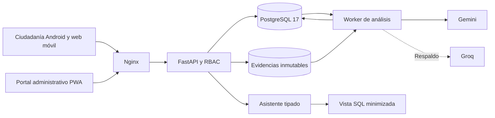

# Semana 13 · Arquitectura y capacidad

## Escenario de dimensionamiento

Supuesto de evaluación, sin demanda histórica de producción: 120 reportes por día. La media de veinticuatro horas es 0,083 reportes/minuto. Se evalúa un pico sostenido hipotético de 4 reportes/minuto. Con un tiempo medio de servicio supuesto de 8 s, la Ley de Little en régimen estable da `L = (4/60) × 8 = 0,53` trabajos activos. Con 30 % de margen, `L ≈ 0,69`. Un worker sirve 7,5 reportes/minuto bajo esa hipótesis. Su ritmo neto frente al pico sería 3,5/min. La relación no garantiza SLA ante esperas del proveedor, leases o errores de modalidad.

| Magnitud | Supuesto o límite |
| --- | --- |
| Llamadas con margen de 30 % | 5,2 RPM si hay un intento por reporte |
| Llamadas con respaldo en todos los trabajos | Hasta 10,4 RPM distribuidas entre proveedores |
| Tokens de planificación por llamada | 2.000 de entrada y 400 de salida, supuesto |
| TPM con respaldo | Hasta 24.960 TPM entre ambos proveedores en el escenario |
| Reservas locales | 12 RPM y 120.000 TPM por proveedor, 300 llamadas y 1,8 M tokens estimados por día en el sistema |
| Corte de 20 min a 4/min | Hasta 80 trabajos acumulados, bajo capacidad de recepción |
| Vaciado al restablecer servicio | 80 ÷ 3,5 ≈ 23 min bajo el escenario base |
| Costo ilustrativo | 120 llamadas × día × (0,002 × tarifa de entrada por millón + 0,0004 × tarifa de salida por millón) USD |

Las cuotas contractuales y tarifas de cuenta requieren verificar panel y modelos validados. El costo ilustrativo permite sustituir precios específicos y sumar audio por separado. Las cuotas locales cuentan intentos y ventanas, con estimación previa conservadora de tokens. PostgreSQL y un worker acotado evitan un segundo sistema de colas y conservan la atomicidad de recepción. Réplicas de worker y una ruta de egreso independiente son opciones posteriores si el backlog, los tiempos reales y el presupuesto lo sustentan.

FastAPI atiende autenticación, estadísticas SQL, estado, validación y deduplicación con código tradicional. Gemini y Groq se reservan para inferencia. El fallback responde a indisponibilidad. La reducción de llamadas se obtiene mediante consultas deterministas y preprocesamiento. [Clase 13](https://ingenieria-aplicaciones-ia.netlify.app/semana13/slides) y [reto de escala](https://ingenieria-aplicaciones-ia.netlify.app/semana13/workshop).

Las mediciones locales y su alcance aparecen en [estado.md](estado.md).
