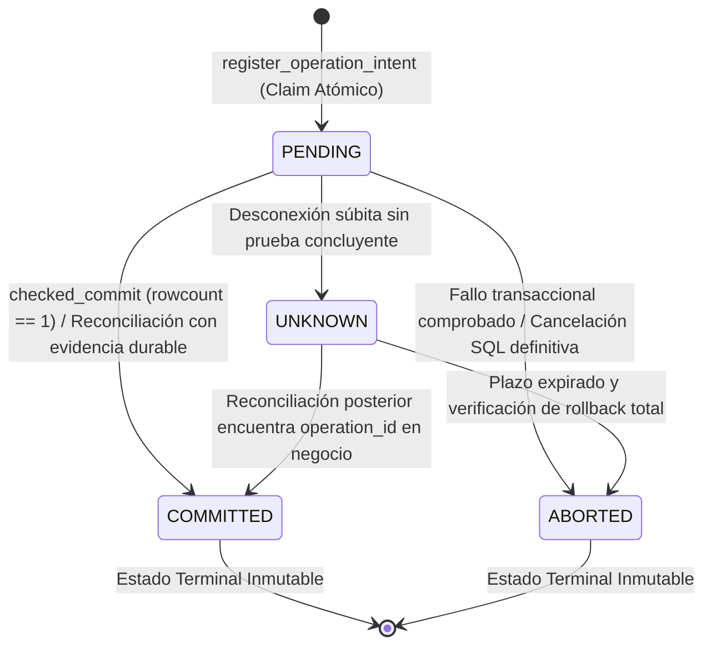

# CIVIA — Especificación de Diseño G2.1.7: Endurecimiento del Registro Transaccional

**Fecha:** 2026-11-03  
**Rama:** `fix/auditoria-final`  
**Base:** `f6fe4f6`  

---

## 1. Máquina de Estados Válida y Monótona

El ciclo de vida de una operación transaccional se modela con cuatro estados discretos: `PENDING`, `COMMITTED`, `ABORTED` y `UNKNOWN`.



### Reglas de Transición
1. **PENDING**: Estado inicial tras el reclamo atómico duradero en `operation_records`. Representa una operación en vuelo cuyo resultado final aún no ha sido persistido o verificado.
2. **COMMITTED**: Estado terminal de confirmación. Solo puede alcanzarse si:
   - `checked_commit(conn)` actualiza `operation_records` dentro de la **misma transacción** que los efectos de negocio y verifica `cur.rowcount == 1`.
   - O una reconciliación encuentra un registro en el dominio de negocio que referencia inequívocamente el `operation_id` evaluado.
3. **ABORTED**: Estado terminal de reversión. Solo puede alcanzarse cuando se comprueba fehacientemente que la transacción de PostgreSQL abortó (rollback) y no persiste ningún efecto vinculado al `operation_id`.
4. **UNKNOWN**: Estado conservador de incertidumbre. Se preserva ante pérdida de conexión, fallos de red durante el handshake de cierre o reinicio del proceso sin evidencia terminante de commit ni aborto.
5. **Inmutabilidad de Estados Terminales**: `COMMITTED` y `ABORTED` son estrictamente monótonos; ninguna reconciliación, consulta posterior ni reintento puede sobrescribir un estado terminal.

---

## 2. Protocolo de Reclamación Exclusiva (Atomic Claim)

Para evitar condiciones de carrera tipo TOCTOU (Time-of-Check to Time-of-Use) y ejecuciones concurrentes duplicadas con la misma clave de idempotencia:

### Esquema y Restricciones
- La tabla `operation_records` delimita la unicidad por ámbito: `UNIQUE (requester_id, operation_type, idempotency_key)`.
- Se almacena `payload_hash` (huella SHA-256 canónica de los argumentos de entrada).
- Se almacena `query_token_hash` (huella SHA-256 del token secreto de consulta entregado al solicitante).

### Protocolo de Inserción Atómica
Antes de ejecutar la función de negocio (worker), el orquestador ejecuta en autocommit:
```sql
INSERT INTO operation_records (
    operation_id, requester_id, operation_type, idempotency_key, payload_hash,
    query_token_hash, target_id, status, proposed_payload, backend_pid, created_at, updated_at
) VALUES (
    %s, %s, %s, %s, %s,
    %s, %s, 'PENDING', %s, %s, clock_timestamp(), clock_timestamp()
)
ON CONFLICT (requester_id, operation_type, idempotency_key)
DO UPDATE SET updated_at = operation_records.updated_at
RETURNING *, (xmax = 0) AS is_new_claim;
```

### Resolución de Reclamo
1. **Si `is_new_claim == True`**:
   - Este invocador adquirió exitosamente el reclamo exclusivo.
   - Procede a ejecutar la herramienta con el `operation_id` registrado.
2. **Si `is_new_claim == False`**:
   - Ya existe un registro para esta combinación `(requester_id, operation_type, idempotency_key)`.
   - **Validación de Conflicto de Payload**: Si `existing.payload_hash != incoming_payload_hash`, se rechaza inmediatamente lanzando `IdempotencyConflictError` (HTTP 409 Conflict).
   - **Manejo de Reintento según Estado Existente**:
     - Si `status == 'COMMITTED'`: no se reejecuta ningún efecto de negocio. Se retorna el resultado previamente persistido o una confirmación consistente reconstructible a partir del `operation_id`.
     - Si `status == 'PENDING'`: existe una ejecución concurrente activa. El invocador espera brevemente la finalización del reclamo en vuelo; si concluye en `COMMITTED`, retorna el resultado sin duplicar; si permanece en vuelo al vencer el plazo, eleva `OperationPendingError` con el `operation_id` durable preexistente.

---

## 3. Evidencia Requerida para Estados Terminales y Atomicidad Fail-Closed

### Fail-Closed en `checked_commit`
- Se elimina cualquier uso de `SAVEPOINT` que permita aislar fallos del marcador de auditoría.
- Dentro de la transacción activa de negocio en `conn`:
  ```sql
  UPDATE operation_records
  SET status = 'COMMITTED',
      result_payload = COALESCE(%s, result_payload),
      updated_at = clock_timestamp()
  WHERE operation_id = %s AND status = 'PENDING';
  ```
- Se valida obligatoriamente `cur.rowcount == 1`.
- Si `cur.rowcount != 1` o ocurre cualquier excepción SQL (ej. trigger de rechazo, tabla inexistente, violación de integridad):
  - Se ejecuta `conn.rollback()`.
  - Se eleva una excepción fatal.
  - La transacción de negocio **se aborta completamente**. Jamás se confirma negocio si el marcador no puede persistirse.

### Reconciliación Basada en Identidad Propia
- En `reconcile_operation(operation_id)`:
  - Se consulta si existe evidencia directa en la tabla de negocio que enlace explícitamente `operation_id`:
    `SELECT id, status FROM pending_approvals WHERE operation_id = %s;`
  - Jamás se infiere `COMMITTED` por la existencia de otra propuesta genérica sobre el mismo `report_id`.
  - Jamás se infiere `ABORTED` por la mera ausencia de `backend_pid` en `pg_stat_activity` mientras la operación esté dentro de su ventana de ejecución o no se haya demostrado su aborto en PostgreSQL.
  - En ausencia de certeza positiva de commit o reversión, la operación se mantiene en `PENDING` o `UNKNOWN`.

---

## 4. Política de Acceso a Endpoints y Protección de Información

### `GET /api/operations/{operation_id}`
- **Autenticación y Autorización**:
  - Se admite cabecera `X-Admin-Token` (acceso administrativo verificado contra `ADMIN_TOKEN`).
  - O cabecera `X-Operation-Token` (token de consulta opaco de 32 bytes URL-safe generado al registrar la intención y validado mediante `hmac.compare_digest(sha256(token), query_token_hash)`).
- **Minimización de Datos en Esquema Público (`OperationStatusResponse`)**:
  - `idempotency_key` **se elimina** por completo del esquema de respuesta; nunca se expone a ningún llamador.
  - `result_payload` solo se entrega a llamadores debidamente autenticados (`X-Operation-Token` o `X-Admin-Token`).
  - Consultas anónimas o sin credenciales de propietario reciben únicamente el estado general de procesamiento (`status`, `operation_type`, `created_at`, `updated_at`, `target_id`), protegiendo cualquier dato sensible interno.

---

## 5. Comportamiento de Reintento, Reconstrucción y Propagación

1. **Reintento de Operación `COMMITTED` sin `result_payload`**:
   - Si una operación confirmó su transacción en base de datos pero el worker no alcanzó a guardar `result_payload` por cancelación tardía post-commit:
   - Un reintento con la misma clave de idempotencia detecta `status == 'COMMITTED'` y devuelve la confirmación durable con su `operation_id` estable sin reejecutar sentencias de negocio.
2. **Propagación de `OperationPendingError`**:
   - `OperationPendingError` se captura explícitamente antes de `FuturesTimeoutError` en el supervisor para evitar su degradación a `TimeoutError`.
   - Cuando el supervisor agota el timeout de espera mientras un worker transaccional continúa activo, propaga `OperationPendingError(operation_id=op_id, status="PENDING")` conservando la identidad durable en todas las capas hasta la API REST (`guardrail_triggered="OPERATION_PENDING"`).
3. **Procedencia de Errores PostgreSQL**:
   - Se valida que `is_deadline_cancellation` solo atribuya SQLSTATE `25P04` o `57014` al plazo de la herramienta cuando el tiempo transcurrido sea mayor o igual al deadline efectivo local (`monotonic >= deadline - 0.05`) o la capacidad haya sido revocada.
   - Cancelaciones prematuras por directivas de sesión ajenas (ej. `transaction_timeout` de 50 ms en plazos de 2 s) conservan su causa original como `psycopg.OperationalError` / `TransactionTimeout`.
